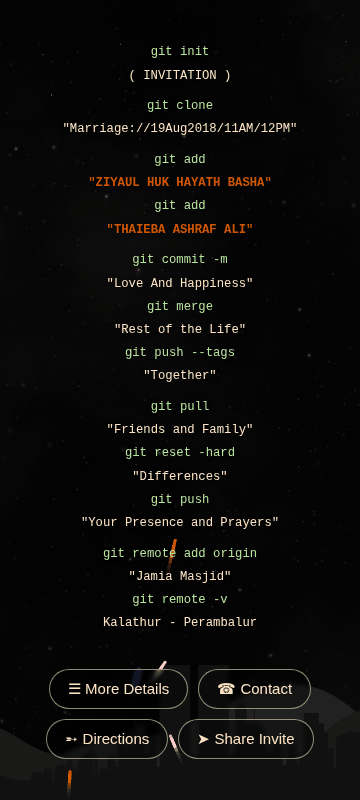

# WedHub — Ziyaul Weds Thaieba

## Why this exists

This is the app I built for my own wedding (19 August 2018) and published on the
[Google Play Store](https://play.google.com/store/apps/details?id=com.ziyaul.wedhub).
Instead of paper invitation cards, the invite *was* an app: a Bluetooth beacon pushed
the Play Store install link directly to guests' phones, one tap away from installing.

<p align="center">
  
</p>

## The original app (2018)

The first version was an Ionic 3 / Cordova app backed by Firebase:

- **RSVP** — a "For RSVP" button asked *"Will you be able to make it?"*; answers were
  stored in Firebase, guests could update them later, and the app nudged anyone who
  opened it without having responded.
- **Calendar invite** — on launch it added the wedding ("Ziyaul Weds Thaieba", Jamia
  Masjid, V Kalathur) to the guest's phone calendar, checking first so it was never
  added twice.
- **Reminders** — that calendar event carried native alerts one day and two hours before
  the wedding, so every guest's phone reminded them on the day itself.

It is preserved untouched in [`legacy/`](legacy/).

## The modern rewrite (this repo)

A few years later I rewrote it from scratch in vanilla TypeScript + Vite + Capacitor.
The rewritten app is purely one-way — it gives information and asks nothing back (no
accounts, no RSVPs), so there was no longer any reason to keep Firebase: every Firebase
dependency was removed, which also means the app now **collects zero data** from users
and works fully offline:

- **Home**: fireworks background with the git-themed invitation and action buttons
  (Contact → dialer, Directions → Google Maps, Share Invite → system share sheet)
- **Details**: invitation card, directions, "Marriage in ISLAM" verses, and the story
  behind this app

## Tech stack

| Piece      | Version | Notes                                        |
| ---------- | ------- | -------------------------------------------- |
| Node.js    | 20.19+  | tested on Node 26                            |
| Vite       | 8.x     | web build (vanilla TypeScript, no framework) |
| Capacitor  | 8.x     | Android packaging (replaces Cordova)         |
| JDK        | 21      | required by Capacitor 8 / AGP                |
| Android SDK| API 36  | compileSdk/targetSdk 36, minSdk 24           |

## Project layout

```
index.html            single-page app (home + details views)
src/main.ts           app logic (fireworks, actions, view switching)
src/style.css         styles (faithful to the original theme)
src/assets/           images + 1024px icon source
capacitor.config.ts   Capacitor config (appId com.ziyaul.wedhub)
android/              native Android project
android/key.properties release signing → ../REDACTED_KEYSTORE_FILE (original Play Store key)
legacy/               the original Ionic 3 / Cordova / Firebase app
```

## Build

One-time environment setup (already done on this machine):

- JDK 21 at `~/tools/jdk21`
- Android SDK at `~/android-sdk` (platform-tools, platforms;android-36, build-tools;36.0.0)

Build steps:

```bash
npm install
npm run build                 # web app → dist/
npx cap sync android          # copy dist into the Android project
cd android
JAVA_HOME=~/tools/jdk21 ANDROID_HOME=~/android-sdk ./gradlew bundleRelease assembleRelease
```

Outputs:

- `android/app/build/outputs/bundle/release/app-release.aab` → **upload this to Google Play**
- `android/app/build/outputs/apk/release/app-release.apk` → install on a device for testing

## Notes

- The old app's login/RSVP/calendar features depended on Firebase and were removed.
  Contact / Directions / Share all work offline via system intents.
- To change the phone number or maps destination, edit the constants at the top of `src/main.ts`.
